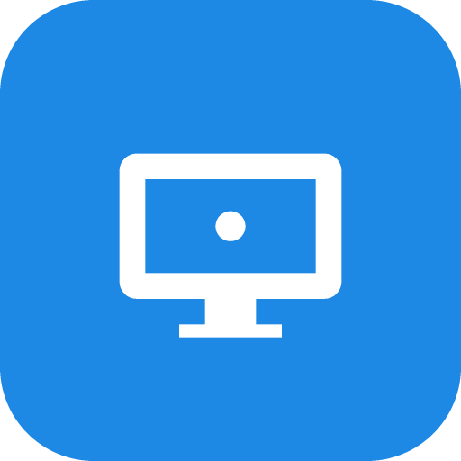
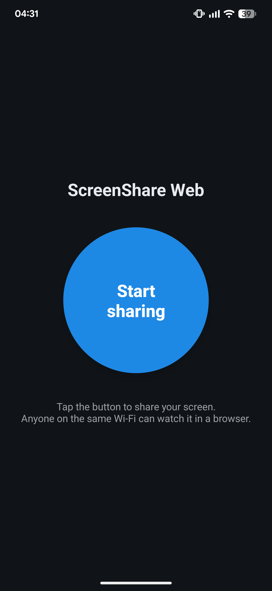
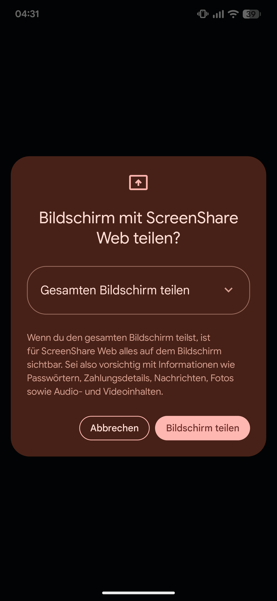
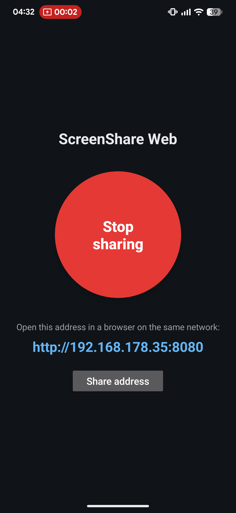

<p align="center">
  
</p>

<h1 align="center">ScreenShare Web</h1>

<p align="center">
  Share your Android screen to any web browser on your local network. One tap, no app needed on the viewer's side.
</p>

<p align="center">
  
  
  
</p>

---

## What it does

1. Tap the big **Start sharing** button and confirm Android's built-in screen-capture prompt.
2. The app shows an address such as `http://192.168.1.23:8080`.
3. Open that address in any browser (laptop, TV, tablet, another phone) on the **same Wi-Fi** or on your phone's **hotspot**.
4. Tap **Share address** to send the link through any app.

Sharing keeps running in the background with a notification that has a **Stop** button. Stopping via Android's own screen-sharing indicator works too.

## Features

- Uses Android's built-in screen sharing (MediaProjection). No root needed.
- Works in every browser: the stream is plain MJPEG over HTTP, so there's nothing to install for viewers.
- Handles screen rotation.
- No accounts, no cloud, no tracking, no third-party libraries. Nothing leaves your local network.
- Small: under 1 MB.

Requires Android 8.0 (API 26) or newer.

## Security note

The stream is **not** password-protected or encrypted. Anyone on the same network who knows the address can watch while sharing is active. Only use it on networks you trust, and stop sharing when you're done.

## How it works

| Component | File | Purpose |
|---|---|---|
| Main screen | [`MainActivity.kt`](app/src/main/java/com/sharescreenweb/MainActivity.kt) | Button, address display, share sheet |
| Capture service | [`ScreenShareService.kt`](app/src/main/java/com/sharescreenweb/ScreenShareService.kt) | Foreground service: MediaProjection → `ImageReader` → JPEG (about 15 fps, max 1280 px) |
| Web server | [`MjpegServer.kt`](app/src/main/java/com/sharescreenweb/MjpegServer.kt) | Tiny HTTP server: viewer page at `/`, MJPEG stream at `/stream`, single frame at `/frame.jpg` |
| Network | [`NetworkUtils.kt`](app/src/main/java/com/sharescreenweb/NetworkUtils.kt) | Finds the device's Wi-Fi or hotspot IPv4 address |

The server listens on port 8080. If that port is taken, it uses the next free port up to 8099.

## Building

Requirements: JDK 17 or newer and the Android SDK (platform 36).

```sh
# Point Gradle at your SDK (or set ANDROID_HOME)
echo "sdk.dir=/path/to/Android/Sdk" > local.properties

./gradlew assembleDebug      # → app/build/outputs/apk/debug/app-debug.apk
./gradlew assembleRelease    # unsigned release APK
```

Install on a connected device:

```sh
adb install -r app/build/outputs/apk/debug/app-debug.apk
```

## F-Droid

Store metadata (title, descriptions, icon, changelogs) lives in [`fastlane/metadata/android`](fastlane/metadata/android) and is picked up by F-Droid automatically. The build recipe submitted to [fdroiddata](https://gitlab.com/fdroid/fdroiddata) is in [`fdroid/`](fdroid/).

### Releasing a new version

1. Bump `versionCode` and `versionName` in [`app/build.gradle.kts`](app/build.gradle.kts).
2. Add `fastlane/metadata/android/en-US/changelogs/<versionCode>.txt`.
3. Commit, then tag it: `git tag v<versionName> && git push --tags`.

F-Droid detects new tags automatically and builds the release.

## Google Play

Signing setup, store texts and the answers for every Play Console form are in [`play/README.md`](play/README.md). The privacy policy is published at <https://aiko929.github.io/ShareScreenWeb/privacy-policy.html>.

## License

[GNU General Public License v3.0 or later](LICENSE)
